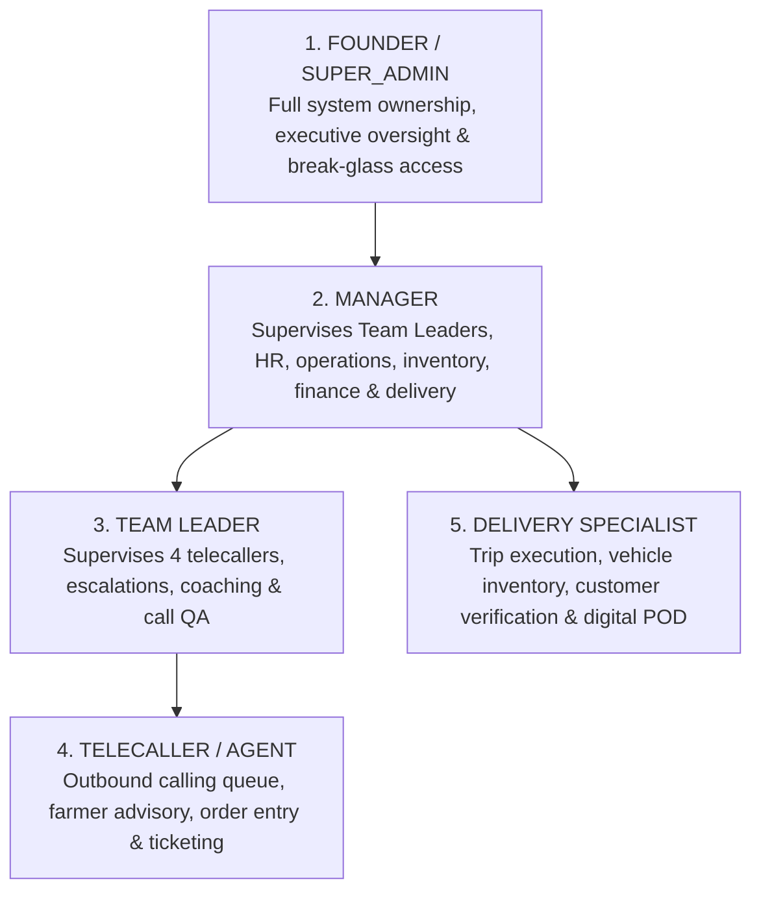
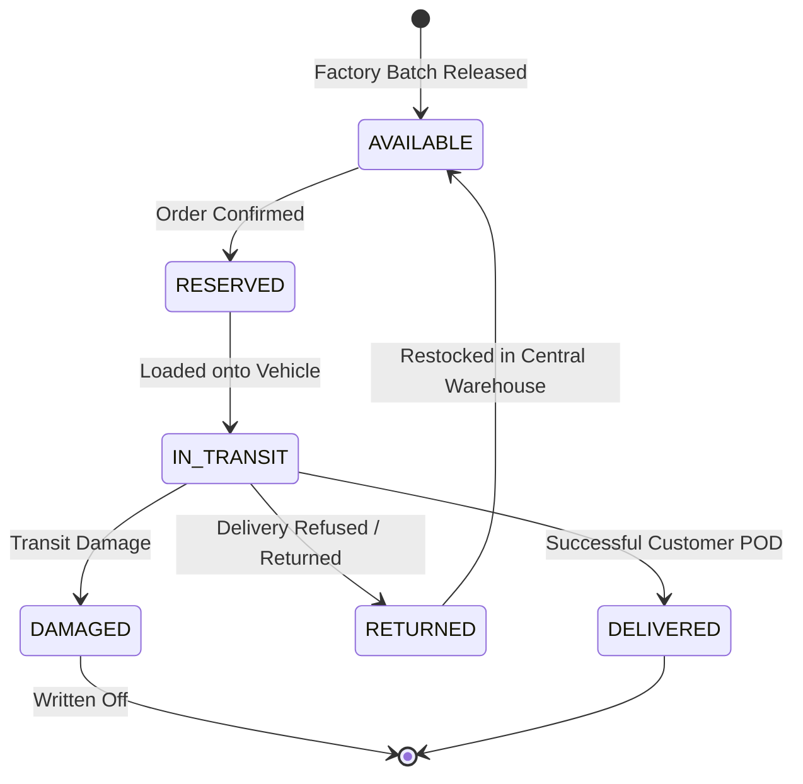

# GROTEC FarmerOS — Comprehensive Project Explanation

> **Version:** 0.1.0  
> **Architecture:** Monorepo (NestJS 10 REST API + React 18 / Vite 5 SPA + Shared Domain Core + Capacitor Android APK)  
> **Database:** PostgreSQL (Supabase) with Prisma ORM 6  
> **Primary Domain:** Enterprise Agri-Tech Operating System: Farmer Telecalling CRM, Supply Chain & Logistics, and HRMS People Operations

---

## Table of Contents

1. [Executive Summary & Company Context](#1-executive-summary--company-context)
2. [High-Level Architecture](#2-high-level-architecture)
3. [Monorepo Directory Layout](#3-monorepo-directory-layout)
4. [Identity, Roles & Access Control (RBAC)](#4-identity-roles--access-control-rbac)
5. [Core Functional Modules](#5-core-functional-modules)
   - [5.1 Farmer Master & Address Hierarchy](#51-farmer-master--address-hierarchy)
   - [5.2 Telecalling & Agent Calling Workspace](#52-telecalling--agent-calling-workspace)
   - [5.3 Leads & Long-Term Relationship Management](#53-leads--long-term-relationship-management)
   - [5.4 Agronomy Knowledge Base & AI Assistant](#54-agronomy-knowledge-base--ai-assistant)
   - [5.5 Factory, Products & Production Batches](#55-factory-products--production-batches)
   - [5.6 Inventory Ledger & State Machine](#56-inventory-ledger--state-machine)
   - [5.7 Sales Orders, Pricing & Approval Hierarchies](#57-sales-orders-pricing--approval-hierarchies)
   - [5.8 Regional Delivery Corridors & Fleet Dispatch](#58-regional-delivery-corridors--fleet-dispatch)
   - [5.9 Field Delivery Mobile App & Digital POD](#59-field-delivery-mobile-app--digital-pod)
   - [5.10 Exception Centre & Quantity Reconciliation](#510-exception-centre--quantity-reconciliation)
   - [5.11 Invoicing, Payments & GST Accounting](#511-invoicing-payments--gst-accounting)
   - [5.12 Customer Support & Escalation Tickets](#512-customer-support--escalation-tickets)
   - [5.13 HRMS: Attendance & eSSL Biometrics](#513-hrms-attendance--essl-biometrics)
   - [5.14 HRMS: Leave Management](#514-hrms-leave-management)
   - [5.15 HRMS: Payroll, Salary Revisions & Advances](#515-hrms-payroll-salary-revisions--advances)
   - [5.16 HRMS: KPI & Agent Performance Scorecards](#516-hrms-kpi--agent-performance-scorecards)
   - [5.17 Employee Self-Service Action Center](#517-employee-self-service-action-center)
   - [5.18 In-App Notifications & Audit Trail](#518-in-app-notifications--audit-trail)
6. [Platform Infrastructure & Design Patterns](#6-platform-infrastructure--design-patterns)
   - [6.1 Transactional Outbox Pattern](#61-transactional-outbox-pattern)
   - [6.2 Consumer Idempotency](#62-consumer-idempotency)
   - [6.3 Multi-Tenancy Architecture](#63-multi-tenancy-architecture)
   - [6.4 Partial Indexes for Active Ownership](#64-partial-indexes-for-active-ownership)
7. [API & Controller Reference](#7-api--controller-reference)
8. [Frontend Workspaces & Views](#8-frontend-workspaces--views)
9. [Development, Seeding & Testing Guide](#9-development-seeding--testing-guide)
10. [Deployment & Production Artifacts](#10-deployment--production-artifacts)

---

## 1. Executive Summary & Company Context

**GROTEC FarmerOS** is an integrated internal enterprise operating system engineered for **GROTEC Agro Products** (headquartered with manufacturing facilities in Dharmapuri, Tamil Nadu). 

GROTEC manufactures and distributes certified bio-fertilizers, biological fungicides, herbal pest protectors, and organic soil conditioners (under FCO 1985 guidelines). The business model combines:
1. **Direct Farmer Engagement (CRM & Telecalling):** In-house telecallers and agronomists advise farmers on crop-specific pest/disease/nutrient remedies and take orders directly over phone calls.
2. **Rural Supply Chain & Direct-to-Farm Delivery (Logistics):** Dedicated delivery vehicles run across regional agricultural corridors (covering all 38 districts of Tamil Nadu) to deliver products right to farmer holdings with electronic Proof of Delivery (POD).
3. **Factory & Inventory Operations:** Real-time tracking of production batches (manufacturing/expiry dates), multi-state inventory (Available, Reserved, In-Transit, Delivered, Returned, Damaged), and quantity reconciliation.
4. **Internal People Operations (HRMS):** Comprehensive employee management, attendance (with biometric device integration), leave workflows, salary advance ledgers, payroll execution, and KPI performance scorecards.

---

## 2. High-Level Architecture

```mermaid
graph TD
    subgraph Client Layer
        Web[React 18 + Vite SPA<br/>Desktop & Tablet]
        Mobile[Capacitor Android APK<br/>Delivery Drivers / FSEs]
    end

    subgraph API Gateway & Service Layer
        Nest[NestJS 10 REST API<br/>Global prefix: /api/v1]
        Guards[AuthGuard (JWT) + PermissionGuard (RBAC)]
        Swagger[Swagger / OpenAPI Docs<br/>at /api/docs]
    end

    subgraph Core Domain Modules
        CRM[CRM Modules:<br/>Customers, Leads, Calls, Followups, Crops, AI Assistant]
        SCM[Supply Chain & Logistics:<br/>Products, Batches, Inventory, Orders, Routes, Dispatch, Delivery, Exceptions]
        HRMS[HRMS Modules:<br/>Employees, Attendance, Leave, Payroll, KPI, Requests]
        SYS[System Modules:<br/>Tenant, Audit, Outbox, Notifications, Health]
    end

    subgraph Persistence Layer
        Prisma[Prisma ORM 6]
        PG[(PostgreSQL / Supabase)]
        Outbox[(Outbox Events Table)]
        Worker[Outbox Worker Service<br/>Lease & Retry Queue]
    end

    Web -->|HTTPS / JSON| Nest
    Mobile -->|HTTPS / JSON / Local Storage| Nest
    Nest --> Guards
    Guards --> CRM
    Guards --> SCM
    Guards --> HRMS
    Guards --> SYS
    CRM & SCM & HRMS & SYS --> Prisma
    Prisma --> PG
    SCM & CRM --> Outbox
    Outbox --> Worker
```

### Technology Stack Summary

| Layer | Technologies |
|---|---|
| **Backend** | NestJS 10, TypeScript / Node.js 20+, Prisma ORM 6, `@nestjs/jwt`, `@nestjs/swagger` 7, `class-validator`, `bcryptjs`, `cookie-parser` |
| **Frontend** | React 18, Vite 5, Tailwind CSS 3, React Router 6, TanStack Query 5 (React Query), `lucide-react`, `axios`, `react-hook-form`, `zod` |
| **Mobile** | Capacitor 6 (Cross-platform WebView wrapper producing native Android APK `grotec-farmeros.apk`) |
| **Shared** | Monorepo package `@grotec/shared` with compiled TypeScript/CJS exports for enums, roles, permissions, phone helpers, and geography constants |
| **Database** | PostgreSQL 15+ (Hosted on Supabase or self-managed), Prisma migrations + custom raw SQL partial unique indexes |
| **Testing** | Vitest 2 across all workspaces (`vitest.step1.config.js` for isolated tests, full suite with supertest) |

---

## 3. Monorepo Directory Layout

```
Grotec-Dev-Project/
├── backend/                  # NestJS REST API Server
│   ├── prisma/
│   │   ├── schema.prisma     # Master schema with 50+ models
│   │   ├── migrations/       # 11+ SQL migrations including partial indexes
│   │   └── seed.js           # Idempotent comprehensive demo seed
│   ├── src/
│   │   ├── app.module.js     # Master application module (36 submodules)
│   │   ├── app-setup.js      # Global pipes, CORS, cookies, Swagger setup
│   │   ├── main.js           # Server bootstrap
│   │   ├── common/           # Cross-cutting concerns (Auth, Audit, Outbox, Prisma, Filters)
│   │   └── modules/          # 36 Feature modules (CRM, HRMS, SCM, etc.)
│   └── test/                 # Test helpers, mocks, Vitest configuration
│
├── frontend/                 # React 18 SPA + Capacitor Android Project
│   ├── src/
│   │   ├── router.tsx        # React Router 6 config with code-splitting
│   │   ├── auth/             # AuthContext, token storage, login/logout
│   │   ├── components/       # Shared UI components, forms, tables, modals
│   │   ├── lib/              # Axios API client, formatting utilities
│   │   └── pages/            # 28+ Page views grouped by domain:
│   │       ├── calling/      # Dedicated Agent Calling Workspace
│   │       ├── customers/    # Farmer profile, multi-location, crop history
│   │       ├── delivery/     # Field delivery, fleet management, manager console
│   │       ├── dispatch/     # Trip planning, route management
│   │       ├── exceptions/   # Quantity discrepancy & return management
│   │       ├── factory/      # Batch tracking, manufacturing logs
│   │       ├── hrms/         # Attendance, Leave, Payroll, Payslips, KPI
│   │       ├── inventory/    # Stock levels, movements ledger
│   │       ├── leads/        # Lead pipeline and ownership
│   │       ├── orders/       # Order management, advance & discount approvals
│   │       ├── relationship/ # Customer Relationship Manager (RM) portfolio
│   │       ├── sales/        # Completed sales & GST invoices
│   │       └── tickets/      # Customer support ticket escalation
│   └── android/              # Native Android wrapper project for APK generation
│
├── packages/
│   └── shared/               # Shared constants, enums, permissions, roles
│       └── src/
│           ├── roles.js      # Role definitions and rank hierarchy
│           ├── permissions.js# 60+ granular permission strings
│           ├── enums.js      # Shared state enums
│           ├── phone.js      # E.164 phone normalizer and validator
│           └── geography.js  # Tamil Nadu districts, taluks, pin codes
│
├── scripts/
│   └── build-android.sh      # Automated bash script for building debug APK via Docker/SDK
├── Dockerfile                # Production multi-stage build Dockerfile
├── build.sh                  # Root build pipeline script
└── render.yaml / vercel.json # Deployment configuration templates
```

---

## 4. Identity, Roles & Access Control (RBAC)

GROTEC FarmerOS enforces a **5-Tier Organizational Role Model** combined with fine-grained permissions checked at both API (NestJS guards) and UI (React route/component guards) levels.

### The 5 Business Roles



1. **Founder (`FOUNDER` / `SUPER_ADMIN`):** Executive access to all financial reports, audit trails, system settings, employee creation, and ultimate escalation decisions.
2. **Manager (`MANAGER`):** Operational supervision: approves salary advances, large discounts (>10%), quantity delivery exceptions, leave requests, payroll runs, and monitors route dispatch.
3. **Team Leader (`TEAM_LEADER`):** Directly manages 4 telecallers, reviews call quality, resolves agent escalations, and reassigns leads/farmers.
4. **Telecaller / Agent (`AGENT`):** Focuses on outbound calling queues, farmer crop advisory, booking orders, scheduling callbacks, and raising support tickets.
5. **Delivery Specialist (`DELIVERY`):** Drivers and field agents running delivery routes, conducting digital Proof of Delivery (signatures, GPS, photos), and logging quantity exceptions.

### Authentication & Token Rotation

- **Access Token:** Short-lived JSON Web Token (JWT) sent via `Authorization: Bearer <token>` header containing `{ sub: employeeId, email, role: roleCode, tenantId }`.
- **Refresh Session:** Stored in the `auth_sessions` table with bcrypt-hashed tokens, device metadata, IP address, and expiry. On every token refresh, the old session is rotated (single-use guarantee).
- **Brute Force Protection:** Login rate-limiting rejects repeated failed login attempts from the same IP/account.

---

## 5. Core Functional Modules

### 5.1 Farmer Master & Address Hierarchy
Farmers are the core customer entity. Because Indian rural address data is multi-dimensional and complex, GROTEC implements a structured address hierarchy:
- **Unique Farmer Code:** System-generated code (e.g., `FARM-2026-0001`).
- **Multiple Phone Numbers:** Stored in `customer_phones`. Every phone is normalized to **E.164** format (`+91XXXXXXXXXX`). Duplicate primary phones are rejected at creation time; if a duplicate is found during entry, the system returns the existing farmer record instead of duplicating.
- **Multiple Farm Locations:** Stored in `customer_locations`. Farmers often own land in multiple locations. The address structure holds:
  - `State` (Default: Tamil Nadu)
  - `District` (e.g., Coimbatore, Salem, Dharmapuri)
  - `Taluk` (Sub-district)
  - `Village`
  - `Pincode`
  - `GPS Coordinates` (Latitude / Longitude for field delivery)
- **Crop Master & Acreage:** Farmers have active crops linked (`customer_crops`) detailing acreage, sowing date, and soil type.
- **Bulk CSV Import:** `POST /api/v1/import/parse` and `execute` allows uploading farmer datasets with automatic phone normalization, duplicate detection, and tolerance for partially incomplete addresses.

### 5.2 Telecalling & Agent Calling Workspace
The telecalling engine drives daily outreach:
- **Agent Calling Queue:** Prioritizes farmers due for callbacks, newly assigned leads, and regular follow-up cycles.
- **Provider Abstraction:** Outbound telephony sits behind a dialer interface (with mock dialer registered for local development and hooks for Exotel / Knowlarity / Cloud Telephony in production).
- **The 3 Canonical Call Outcomes (PRD §6.3.6):**
  1. `INTERESTED`
  2. `NOT_INTERESTED`
  3. `NOT_ANSWERED`
  *(Outcome and Next Action are strictly decoupled to preserve clean analytical metrics).*
- **Next Actions:** For `INTERESTED` calls, agents must pick exactly one:
  - `CALLBACK`: Schedules a specific callback timestamp which appears in the follow-up calendar.
  - `SALES`: Directs the agent to book a sales order immediately.

### 5.3 Leads & Long-Term Relationship Management
GROTEC separates temporary acquisition leads from lifetime farmer relationships:
- **Leads Pipeline:** Represents new prospects. Stored in `leads` with an append-only `lead_ownership` table enforcing **exactly one active owner** at any time.
- **Relationship Management (RM):** Long-term farmer relationships are held in `relationship_ownership`. Farmers can be assigned to designated Relationship Managers. An **Unassigned Pool** allows managers to balance workloads across the team.

### 5.4 Agronomy Knowledge Base & AI Assistant
During a live call, agents must provide expert agricultural advice:
- **Crop Product Guidance:** Database of pest, disease, weed, and nutrient problems mapped to GROTEC products with exact dosage and application instructions.
- **AI Agronomy Assistant:** An embedded LLM chat widget (powered by OpenAI / Anthropic / Local models via configurable env) trained on GROTEC's organic product catalog. Agents can type: *"Tomato leaves curling with whiteflies"* and receive immediate Tamil/English guidance on combining `Trishul` and `Asthra`.

### 5.5 Factory, Products & Production Batches
Covers production at the Dharmapuri plant:
- **Product Categories:** Bio-Fertilizers, Bio-Fungicides, Bio-Pest Protectors, Plant Growth Stimulants, Soil Conditioners.
- **SKU & Catalog:** `Product` model tracks SKU, package size (1L, 1KG, 50KG Bag), HSN code, base price, and 5% agricultural GST.
- **Production Batches:** Tracks `batch_number`, manufacturing date (`mfg_date`), expiry date (`exp_date`), `quantity_produced`, and `quantity_remaining`.

### 5.6 Inventory Ledger & State Machine
Inventory is tracked across strict physical states in `inventory_stocks` and audit-logged in `inventory_movements`:



### 5.7 Sales Orders, Pricing & Approval Hierarchies
- **Order Booking:** Telecallers create orders for farmers with multi-line items.
- **Discount Governance:**
  - Standard discounts apply automatically.
  - Large discount requests require **Manager approval** before order confirmation.
- **Advance Payment Policy:**
  - Orders exceeding policy thresholds require advance payment.
  - Advance exceptions require explicit approval by the Manager or Founder.
- **Confirmation State:** Moves from `DRAFT` → `SUBMITTED` → `CONFIRMED` → `DISPATCHED` → `DELIVERED` → `COMPLETED`.

### 5.8 Regional Delivery Corridors & Fleet Dispatch
Tamil Nadu is partitioned into **4 Primary Delivery Corridors**:
1. **Coimbatore Route:** Western industrial & Kongu region (Coimbatore, Tiruppur, Erode, Salem, Namakkal, Nilgiris, Dharmapuri, Krishnagiri).
2. **Vellore–Chennai Route:** Northern agro-belt & metropolitan corridor (Vellore, Ranipet, Tirupathur, Tiruvannamalai, Kanchipuram, Tiruvallur, Chengalpattu, Chennai).
3. **Madurai Route:** Southern agro-belt & rainfed black-soil region (Madurai, Dindigul, Theni, Virudhunagar, Sivaganga, Ramanathapuram, Tirunelveli, Tenkasi, Thoothukudi, Kanniyakumari).
4. **Tiruchirappalli Route:** Central Cauvery Delta & coastal belt (Trichy, Karur, Perambalur, Ariyalur, Thanjavur, Tiruvarur, Nagapattinam, Mayiladuthurai, Pudukkottai, Cuddalore, Kallakurichi, Viluppuram).

- **Dispatch Trips:** Managers allocate confirmed orders to a `Trip`, assigning a vehicle (e.g., Tata 407 LPT Heavy) and driver. Trip stops are sequenced logically.

### 5.9 Field Delivery Mobile App & Digital POD
Delivery drivers use the Capacitor-wrapped mobile application (`DeliveryMobilePage.tsx`):
- **Trip Dashboard:** Displays today's scheduled stops and customer addresses.
- **Offline Resilience:** Allows drivers to view customer location and order details even with patchy rural connectivity.
- **Electronic Proof of Delivery (POD):**
  - Driver captures **customer signature** directly on screen (HTML5 canvas).
  - Driver captures **delivery photo** (farm gate or unloaded product).
  - Device records **GPS latitude and longitude** at the moment of completion.
  - Customer receives instant payment / delivery receipt confirmation.

### 5.10 Exception Centre & Quantity Reconciliation
When a delivery cannot be fulfilled as planned (e.g., farmer only wants 3 of 5 bottles, or product leaked during transit):
- Driver files a `QuantityException` from the mobile app with a photo and note.
- Order is held in the **Exception Centre**.
- Manager reviews the exception:
  - Approves partial delivery.
  - Triggers automated invoice revision.
  - Adjusts remaining vehicle inventory so excess items return to the central warehouse ledger.

### 5.11 Invoicing, Payments & GST Accounting
- **Invoices:** Generated upon order dispatch with sequential numbering (e.g., `INV-2026-0001`), computing Subtotal, CGST (2.5%), SGST (2.5%), or IGST (5.0%).
- **Revised Invoices:** If delivery quantities change, the invoice is revised with an audit trail and reason.
- **Payments:** Tracks cash, UPI, bank transfer, or advance payments with reconciliation verification.

### 5.12 Customer Support & Escalation Tickets
- Integrated ticketing system for farmer complaints (germination issues, product usage queries, delivery delays).
- Tickets carry priorities (`LOW`, `MEDIUM`, `HIGH`, `URGENT`) and status (`OPEN`, `ASSIGNED`, `IN_PROGRESS`, `RESOLVED`, `CLOSED`).
- Can be assigned to technical agronomists, logistics managers, or team leaders.

### 5.13 HRMS: Attendance & eSSL Biometrics
- **Dual Attendance Source:** Supports manual check-in/out and automated biometric punch sync from **eSSL biometric fingerprint/facial devices**.
- **Webhook Endpoint:** Device gateway sends punches to `/api/v1/attendance/essl/punch` authenticated via `x-essl-secret`.
- **Approval Workflow:** Exceptions (late arrivals, missing punches) trigger an approval workflow where managers review and regularize attendance.

### 5.14 HRMS: Leave Management
- **Leave Types:** Paid Leave (PL), Casual Leave (CL), Sick Leave (SL), Maternity/Paternity Leave.
- **Balances:** Real-time balances tracked per employee.
- **Workflow:** Employee submits application → Team Leader/Manager approves or rejects → Leave balance automatically debited.

### 5.15 HRMS: Payroll, Salary Revisions & Advances
- **Salary Structures:** Defines base salary, HRA, special allowances, and statutory deductions.
- **Advance Ledger:** Employees can request salary advances. Approved advances are tracked in `advance_ledgers` and systematically recovered across payroll runs via `advance_recoveries`.
- **Payroll State Machine:**
  `IDLE` → `GENERATED` → `APPROVED` / `LOCKED` → `PAID`
- **Payslips:** Digital payslips accessible by employees in their portal.

### 5.16 HRMS: KPI & Agent Performance Scorecards
- **Metrics Catalog:** Number of dials, connected calls, talk time, interested conversion rate, orders booked, and sales revenue.
- **Scoring Engine:** Computes monthly achievement percentages against targets with weighted scores.
- **Leaderboards & Coaching:** Team leaders view agent rankings and record coaching feedback notes.

### 5.17 Employee Self-Service Action Center
A consolidated hub (`ActionCenterPage.tsx`) where employees can:
- Submit HR requests (salary advance, equipment, documents, grievance).
- View pending approvals assigned to them.
- Check today's tasks and follow-up deadlines.

### 5.18 In-App Notifications & Audit Trail
- **In-App Notifications:** Real-time alert badges for callbacks, order approvals, leave approvals, and system broadcasts.
- **Immutable Audit Log:** `AuditEvent` records `actor_id`, `entity_type`, `entity_id`, `action`, and JSON snapshots of `before_state` and `after_state`.

---

## 6. Platform Infrastructure & Design Patterns

### 6.1 Transactional Outbox Pattern
To avoid distributed transaction failures when notifying external systems (SMS gateways, analytics, webhooks):
1. Any state mutation writes a domain event row to `outbox_events` within the **exact same database transaction** as the business record.
2. The `OutboxWorker` periodically leases pending events using database timestamps (`lease_expires_at`).
3. Events are processed asynchronously with automated exponential backoff retries.

### 6.2 Consumer Idempotency
To prevent double-processing of events:
- The `processed_events` table maintains a unique constraint on `(event_id, consumer_name)`.
- If a worker crashes after completing a task but before clearing the outbox queue, the consumer checks `processed_events` and skips redundant execution.

### 6.3 Multi-Tenancy Architecture
- Every core entity contains a nullable `tenant_id` referencing `Tenant`.
- The system supports isolated multi-tenant data while currently operating with the default enterprise tenant (`GROTEC`).

### 6.4 Partial Indexes for Active Ownership
Prisma cannot natively express SQL partial indexes, but PostgreSQL supports them. GROTEC maintains partial unique indexes in raw SQL migrations:
```sql
-- Ensures only ONE active relationship owner per customer
CREATE UNIQUE INDEX "relationship_ownership_active_idx" 
ON "relationship_ownership" ("customer_id") 
WHERE "is_active" = true;

-- Ensures only ONE active lead owner per lead
CREATE UNIQUE INDEX "lead_ownership_active_idx" 
ON "lead_ownership" ("lead_id") 
WHERE "is_active" = true;
```

---

## 7. API & Controller Reference

All endpoints are hosted under prefix `/api/v1` and documented via Swagger at `/api/docs`:

| Module | Key Routes | Description |
|---|---|---|
| **Auth** | `POST /auth/login`<br/>`POST /auth/refresh`<br/>`POST /auth/logout` | JWT authentication and session rotation |
| **Customers** | `GET /customers`<br/>`POST /customers`<br/>`GET /customers/:id`<br/>`POST /customers/:id/locations` | Farmer master directory and farm locations |
| **Calls** | `GET /calls/queue`<br/>`POST /calls/start`<br/>`POST /calls/:id/outcome` | Calling queue and 3-outcome disposition |
| **Followups** | `GET /followups`<br/>`PATCH /followups/:id/complete` | Scheduled callbacks and calendar |
| **Leads** | `GET /leads`<br/>`POST /leads`<br/>`POST /leads/:id/assign` | Lead acquisition and ownership transfer |
| **Relationship** | `GET /relationship/roster`<br/>`GET /relationship/unassigned`<br/>`POST /relationship/assign` | RM assignment and customer portfolio |
| **Assistant** | `GET /assistant/guidance`<br/>`POST /assistant/chat` | Agronomy knowledge base and AI chat |
| **Orders** | `GET /orders`<br/>`POST /orders`<br/>`PATCH /orders/:id/confirm`<br/>`POST /orders/:id/discount/request` | Sales order lifecycle and discount approvals |
| **Products** | `GET /products`<br/>`POST /products` | Product catalog, pricing, and GST |
| **Inventory** | `GET /inventory/stocks`<br/>`GET /inventory/movements` | Multi-state warehouse stock ledger |
| **Production** | `GET /production/batches`<br/>`POST /production/batches` | Factory manufacturing batch tracking |
| **Routes** | `GET /routes`<br/>`POST /routes/:id/districts` | Regional delivery corridor configurations |
| **Dispatch** | `GET /dispatch/trips`<br/>`POST /dispatch/trips`<br/>`GET /dispatch/vehicles` | Trip planning and vehicle loading |
| **Delivery** | `GET /delivery/active-trip`<br/>`POST /delivery/stops/:id/complete` | Mobile driver stops and digital POD |
| **Exceptions** | `GET /exceptions/pending`<br/>`POST /exceptions/:id/review` | Quantity delivery exception approvals |
| **Sales** | `GET /sales`<br/>`GET /sales/:id/invoice` | Completed sales and GST tax invoices |
| **Tickets** | `GET /support-tickets`<br/>`POST /support-tickets` | Farmer support escalation tickets |
| **Attendance** | `GET /attendance`<br/>`POST /attendance/punch`<br/>`POST /attendance/essl/punch` | Biometric eSSL & manual attendance logs |
| **Leave** | `GET /leave/types`<br/>`POST /leave/apply`<br/>`PATCH /leave/:id/review` | Leave quota, balance & approvals |
| **Payroll** | `GET /payroll/runs`<br/>`POST /payroll/generate`<br/>`GET /payroll/payslips` | Salary runs, advances & payslips |
| **KPI** | `GET /kpi/targets`<br/>`GET /kpi/team-summary/:period` | Agent monthly performance scorecards |
| **Reports** | `GET /reports/agent-performance`<br/>`GET /reports/sales-summary` | Executive reports & telecaller rankings |
| **Audit** | `GET /audit` | Immutable system audit trails |

---

## 8. Frontend Workspaces & Views

The React SPA dynamically tailors the sidebar and accessible routes according to the user's role:

| Workspace / View | Route | Primary Audience | Key Functionality |
|---|---|---|---|
| **Executive Dashboard** | `/dashboard` | Founder, Manager | High-level metrics: revenue, calls made, deliveries, pending approvals |
| **Agent Calling Console** | `/agent` | Telecaller, Team Leader | Streamlined calling queue, live note-taking, 3-outcome logger, AI widget |
| **Action Center** | `/action-center` | All Employees | Consolidated task management, pending approvals, and self-service requests |
| **Farmer Directory** | `/customers` | All CRM Staff | Searchable list of 5,000+ farmers, crop profiles, land holdings, phone list |
| **Farmer Detail View** | `/customers/:id` | All CRM Staff | Complete 360-degree customer view: order history, call logs, locations |
| **Relationship Manager** | `/relationship` | Founder, Manager, RMs | Long-term farmer portfolio ownership and unassigned pool rebalancing |
| **Sales Orders** | `/orders` | Sales, Telecallers | Order creation, discount requests, advance payment tracking |
| **Completed Sales & Tax** | `/sales` | Accounts, Founder | Completed sales, issued invoices, CGST/SGST/IGST breakdown |
| **Inventory Ledger** | `/inventory` | Warehouse, Manager | Real-time stock counts across states (Available, Reserved, In-Transit) |
| **Factory & Batches** | `/factory` | Production Manager | Batch production records, mfg/exp dates, factory logs |
| **Regional Dispatch** | `/dispatch` | Logistics Manager | Trip planning, 4 regional routes, vehicle assigning, stop ordering |
| **Fleet & Vehicles** | `/delivery/fleet` | Logistics Manager | Vehicle catalog (Tata 407), driver assignment, odometer logs |
| **Field Delivery (Mobile)** | `/delivery` | Delivery Drivers | Mobile-optimized touch UI: stop checklist, map link, digital POD capture |
| **Exception Centre** | `/exceptions` | Manager, Founder | Resolution of delivery quantity discrepancies and excess stock returns |
| **Support Tickets** | `/tickets` | Support, Agents | Farmer grievance and agronomy escalation ticket tracking |
| **HR Operations Hub** | `/hrms` | Founder, Manager | Employee directory, attendance overview, payroll overview |
| **Team Attendance** | `/hrms/attendance`| All Staff | Daily biometric logs, check-in timestamps, regularization requests |
| **Leave Management** | `/hrms/leave` | All Staff | Balance cards, application submission, manager approval workflow |
| **Payroll Processing** | `/hrms/payroll` | Accounts, Manager | Salary runs, advances ledger, deduction review, payslip publication |
| **Personal Payslips** | `/hrms/payslips`| Staff / Agents | Downloadable monthly payslips with earnings/deductions breakdown |
| **KPI Scorecard** | `/hrms/kpi` | Team Leader, Agents | Monthly performance scorecards, target vs actuals, coaching comments |
| **Reports & Rankings** | `/reports` | Management | Telecaller league tables, call duration stats, conversion rates |
| **Audit Log** | `/audit` | Founder | Detailed before/after JSON audit logs of critical entity updates |

---

## 9. Development, Seeding & Testing Guide

### Prerequisites
- **Node.js:** `>= 20.0.0`
- **npm:** `>= 10.0.0`
- **PostgreSQL:** Running locally or on Supabase

### Local Setup Instructions

1. **Clone and Install Dependencies:**
   ```bash
   git clone <repo-url>
   cd Grotec-Dev-Project
   npm install
   ```

2. **Environment Configuration:**
   Copy the example environment file:
   ```bash
   cp backend/.env.example backend/.env
   ```
   *Fill in your database URL (`DATABASE_URL`), direct URL (`DIRECT_URL`), and JWT secret (`JWT_ACCESS_SECRET`).*

3. **Database Migrations:**
   ```bash
   npm run migrate:dev
   ```

4. **Seed Reference & Demo Data:**
   ```bash
   npm run seed
   ```
   *Populates roles, 60+ permissions, 16 crops, bilingual soil types, 14 products, production batches, 4 regional corridors, vehicles, demo farmers, demo calls, and accounts.*

5. **Start Development Servers:**
   - **Backend API:**
     ```bash
     npm run dev:api
     # Runs on http://localhost:3000/api/v1 (Docs at /api/docs)
     ```
   - **Frontend Web SPA:**
     ```bash
     npm run dev:web
     # Runs on http://localhost:5173 (Proxies /api requests to port 3000)
     ```

### Seeded Credentials for Testing

| Email | Role | Default Password |
|---|---|---|
| `founder@grotec.local` | Founder / Super Admin | `Founder@Grotec2026!` (or from `FOUNDER_PASSWORD`) |
| `manager@grotec.local` | Manager / Operations | `Manager@Grotec2026!` |
| `agent_1@grotec.local` | Telecaller / Agent | `Agent1@Grotec2026!` |
| `staff@grotec.local` | Office & HR Staff | `Staff@Grotec2026!` |
| `delivery@grotec.local` | Delivery Specialist | `Driver@Grotec2026!` |

### Automated Testing

- **Isolated Unit & Health Tests (No DB Required):**
  ```bash
  npx vitest run --config backend/vitest.step1.config.js
  ```
- **Master Acceptance Test Suite (38 Acceptance Tests):**
  ```bash
  npx vitest run backend/src/qa-master-implementation.spec.js
  ```
- **Comprehensive Route Audit (Every API Endpoint):**
  ```bash
  npx vitest run backend/src/qa-comprehensive-route-audit.spec.js
  ```

---

## 10. Deployment & Production Artifacts

### Android Mobile App (Capacitor)
The delivery module is compiled into an installable Android APK (`grotec-farmeros.apk`):
```bash
npm run build:apk
# Outputs: grotec-farmeros.apk in root directory
```
Install to connected Android device:
```bash
npm run adb:install
```

### Docker Production Build
A multi-stage `Dockerfile` is provided at root:
- **Stage 1 (Builder):** Compiles `@grotec/shared`, runs NestJS production build, and builds Vite frontend production bundle.
- **Stage 2 (Runner):** Lightweight Node 20 alpine image serving the NestJS API with Prisma client and static frontend assets.

### Cloud Deployment Configurations
- **Vercel:** Configured via `vercel.json` for frontend SPA hosting.
- **Render:** Configured via `render.yaml` for containerized backend API and PostgreSQL database services.

---

*(This document serves as the authoritative architectural and operational specification for GROTEC FarmerOS).*
